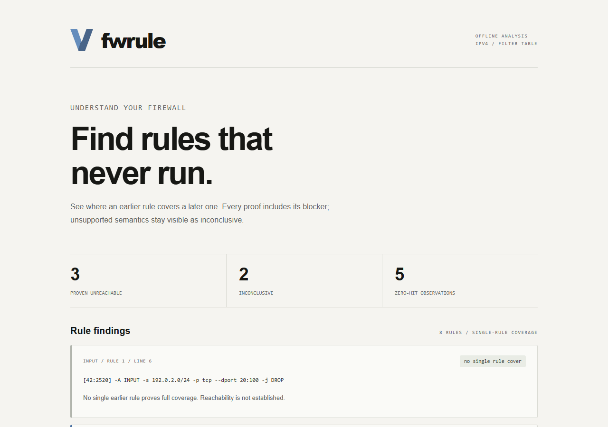

# fwrule

**Find firewall rules that never run — with evidence and explicit limits.**

fwrule is an educational offline analyzer for exported IPv4 iptables-save
rules. It explains when an earlier terminal rule covers every modeled match
of a later rule, separates zero-hit observations from structural findings,
and marks unsupported semantics inconclusive.



## Run

Python 3.10+ is required. No installation, administrator access, runtime packages,
API keys or network connection is needed. From the project folder:

```console
python -m fwrule samples/demo.rules
python -m fwrule samples/demo.rules --format json
python -m fwrule samples/demo.rules --format html -o my-report.html
```

Open the generated HTML in a browser, or view the included
[demo report](samples/demo-report.html). Reports contain no scripts, external
fonts or remote assets. The report uses the cream background, blue mark and
bold typography from Jake's supplied concept image.

The synthetic demo contains eight analyzed rules: **three proven unreachable,
two inconclusive, one partial-overlap finding and five zero-hit observations**.
It is not a policy to install on a real firewall.

To inspect a real policy, obtain an export from a Linux system you own or are
authorized to administer. On that system, `sudo iptables-save -c > rules.v4`
exports optional counters; without `-c`, counters remain unknown. Transfer the
export privately and analyze it locally. This program never runs that command
or touches a firewall. Exports/reports may expose internal addressing and policy:
keep actual evidence under ignored `.private/`, outside public portfolio files.

Exit codes: **0** completed supported analysis (findings may exist), **3** report
generated with inconclusive rules or excluded content, **2** input/output error.
The demo intentionally returns 3. Output files must be new; the CLI never
overwrites the input or an existing report.

## Support and findings

| Dimension | Version 0.1 |
| --- | --- |
| Input | UTF-8 iptables-save, optional BOM and per-rule counters |
| Scope | IPv4 filter table; INPUT, OUTPUT, FORWARD |
| Matches | Numeric source/destination addresses and CIDRs; all/tcp/udp; numeric TCP/UDP ports and closed ranges |
| Actions | ACCEPT, DROP, REJECT without extended options |
| Modules | tcp/udp matching the protocol; comment metadata |
| Evidence | Chain, ordinal rule number, original file line and covering rule |
| Output | Terminal, JSON schema version 1, self-contained HTML |

Exact same match/action is a **duplicate**. Full coverage with a different action
is **conflicting shadowing**; a broader covering rule with the same action is
**same-action shadowing**. Partial overlap is informational: multiple earlier
rules may jointly cover a rule, but this version does not prove union coverage.
A no-cover finding does **not** establish reachability.

Negation, interfaces, connection state, custom-chain calls/RETURN, LOG, unknown
modules/targets and other unsupported syntax make their entire affected built-in
chain inconclusive. Other tables and custom-chain contents are excluded with
warnings. Malformed structure, invalid values and resource excesses are errors.
IPv6, native nftables, NAT behavior and whole-network path analysis are outside
scope. The tool is deliberately conservative; ordinary real exports can produce
many inconclusive results.

Zero packets means zero in the exported counter; its measurement period and
reset history are unknown. Neither a zero counter nor a shadowing result is
automatic removal advice. A structural proof concerns packets arriving at the
given filter chain and only the supported semantics.

## Architecture and security

```text
bounded file -> strict parser -> immutable rules -> ordered coverage -> reports
                     |                              |
                source provenance            blocker evidence
```

`parser.py` retains unmodeled rules as barriers. `analysis.py` compares inclusive
address/port intervals and protocol containment within a chain. `report.py`
escapes input for terminal/HTML display. `__main__.py` manages bounded local
file reads and exclusive report creation.

The threat model includes malicious ruleset text, misleading partial support,
oversized files and display injection. Limits are 2 MiB input, 8,192 characters
per line, 1,000 rules across all tables and 500,000 pair comparisons. There is
no shell execution, name resolution, packet sending or policy modification.
Unknown semantics block proofs. HTML escapes source text, disables scripts with
CSP and uses a one-pass template substitution. See [SECURITY.md](SECURITY.md).

## Verify and learn

```console
python -m unittest discover -s tests -v
python scripts/demo_reports.py --check
python -m bandit -r fwrule scripts -q
```

Bandit is optional for development and is already installed on Jake's machine.
A fresh development environment can install the pinned
`requirements-dev.txt`; it is not needed to use fwrule.

The suite tests malformed/unmodeled syntax, chain/order boundaries, interval
endpoints, counters, output preservation, HTML injection and an independent
packet interpreter over generated fixtures. See [VALIDATION.md](VALIDATION.md)
for actual checks, platform and limitations. GitHub test/Bandit and weekly
CodeQL workflows are prepared with verified immutable action commits; remote
eligibility, permissions, protections and execution await authorized publication.
No remote checks are claimed.

To regenerate the synthetic reports after a change:
`python scripts/demo_reports.py`. It deliberately replaces only the three
fixed sample report artifacts; `--check` compares without writing. Actual CLI
reports retain exclusive-creation protection.

Optional exercise: reverse the broad DROP and specific ACCEPT rules in a copy
of the sample. Explain why the single-rule proof changes to partial overlap.
See [LEARNING.md](LEARNING.md), [DECISIONS.md](DECISIONS.md) and [STATE.md](STATE.md).

## Sources, license and assistance

Original implementation under the [MIT license](LICENSE). No upstream project
code was copied. Semantic/research references reviewed October 5, 2026:

- [Netfilter packet filtering documentation](https://www.netfilter.org/documentation/HOWTO/packet-filtering-HOWTO-7.html)
- [FFFUU / Iptables Semantics](https://github.com/diekmann/Iptables_Semantics):
  formal semantics, parser and test-design reference; BSD-2-Clause project.
  fwrule is **not** formally verified and does not inherit FFFUU's guarantees.
- [Springbok](https://github.com/conix-security/audit-springbok):
  anomaly-analysis comparison; no code reused and licensing was not established.

Built with Codex assistance for implementation, source review, tests and fixes.
Local Ollama qwen3.5:2b supplied a short reviewed introduction draft. Its earlier
truncated test-idea draft had semantic mistakes and was rejected; raw evidence
is preserved separately in Jake's private shared tooling records.

## Publication status

See [publication review](PUBLICATION.md) for the October 5 source snapshot, fresh local checks, evidence boundaries and current hosted-check distinction.
